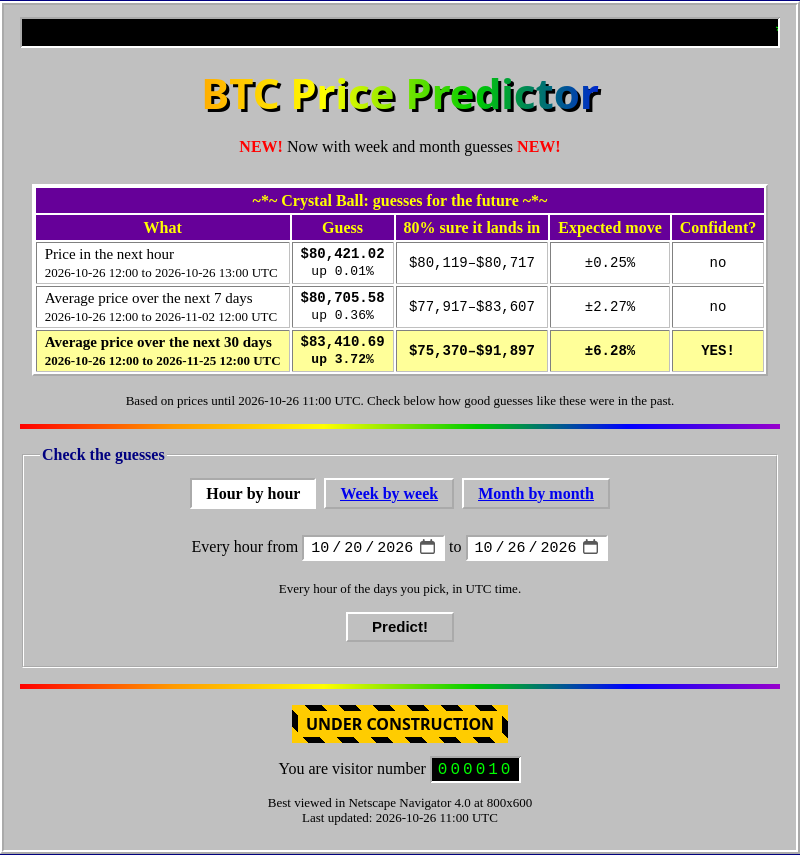

# BTC Price Predictor

A website that guesses the Bitcoin price for the next **hour**, **7 days** and **30 days**, and shows honestly how good those guesses were in the past.

Final project in DAT158, autumn 2026. The report is in [`report/`](report/).

**Live site:** *(add the link here after deploying; the free host sleeps when nobody visits, so the first visit can take a minute)*



## What it does

- **Crystal ball:** for the next hour, week and month: the guessed (average) price, up or down, the expected size of the move, an 80% range the price should land in, and whether the guess is one of the model's *confident* ones.
- **Test bench:** pick hours, weeks or months in the past. The site replays the model step by step, using only the prices it could have known at the time, and shows a chart, every guess, and a report card: how often the direction was right, the chance that this is just luck, and how often the price landed inside the 80% range.

Prices are hourly BTC/USDT candles from the Binance public API, from January 2018 until now.

## How it works

Two ridge regressions per horizon (`btc_model.py`):

- the **change model** guesses the % change of the average price from the price and volume changes of the last 4 periods,
- the **move model** guesses the size of the move from how wild the market was lately (recent moves, high–low range, hour of day, day of week).

The 80% range and the "confident" cut-off are calibrated on the training data. Everything is tested **walk-forward**: the model re-learns at the start of every month, only from periods that were over by then.

## Results (test period 1 Jan 2021 – 26 Oct 2026)

| | Hour | Week | Month |
|---|---:|---:|---:|
| Guesses | 50,927 | 303 | 69 |
| Right direction | **52.6%** (chance it's luck < 0.01%) | 47.5% (82%) | 58.0% (11%) |
| "Always up" baseline | 50.5% | 50.8% | 58.0% |
| "Opposite of last period" baseline | 52.7% | 51.5% | 49.3% |
| Right direction, confident guesses | **55.0%** | 49.0% | 60.0% |
| Real price inside the 80% range | 79.4% | 75.9% | 79.7% |
| Move-size guess vs. always guessing the average move | **22.6% better** | 10.2% better | 6.9% worse |

In short: **how big the move will be** is quite predictable, **which way it goes** barely is. The hourly direction edge is real but tiny (it is mostly "the last hour's move partly reverses"), and far too small to beat trading fees. Week and month have too few guesses to tell skill from luck. See the report and `experiments.ipynb` for baselines, other models, feature importance and error analysis.

## Files

| File | What it is |
|---|---|
| `app.py`, `templates/`, `static/` | The website (Flask) |
| `btc_data.py` | Downloads hourly prices from Binance into `btc_1h.csv` (only new hours after the first run) |
| `btc_model.py` | Features, the model, the walk-forward test and the scores, shared by the notebooks and the website |
| `ML2.ipynb` | Main notebook: data, features, walk-forward test, forecasts |
| `experiments.ipynb` | Everything behind the report: baselines, other models, look-back window, feature importance, error analysis, trading test. Saves the figures to `report/figures/` |
| `btc_1h.csv` | Hourly prices since 2018, so you don't have to download them all again |
| `report/` | The report (`.docx` and `.pdf`) and its figures |
| `Dockerfile`, `compose.yaml`, `.env.example`, `render.yaml` | Deployment: the container, running it on your own server (with Cloudflare Tunnel), and Render |

## Run it yourself

Needs Python 3.14 (other recent versions probably work too).

```bash
git clone https://github.com/tjommilaskus/ml-innlevering_2.git
cd ml-innlevering_2
python3 -m venv .venv
source .venv/bin/activate          # Windows: .venv\Scripts\activate
pip install -r requirements.txt
python3 app.py
```

Then open http://localhost:5000.

### Reproduce the results

```bash
pip install jupyter
jupyter nbconvert --to notebook --execute --inplace ML2.ipynb
jupyter nbconvert --to notebook --execute --inplace experiments.ipynb   # about 10 minutes
```

`experiments.ipynb` stops the prices at 26 Oct 2026, so it gives the same numbers as the report every time. `ML2.ipynb` uses all prices until now, so its numbers move a little as new hours come in.

## Deploy it

**Your own server, with Docker Compose:**

```bash
git clone https://github.com/tjommilaskus/ml-innlevering_2.git
cd ml-innlevering_2
docker compose up -d --build
```

The site is then on port 8000 of the server. It restarts by itself after a reboot, and Docker checks every minute that it answers. To update, run `git pull` and `docker compose up -d --build` again. The prices saved inside the container are reset to the ones in the repository when the container is recreated; the site then fetches the missing hours from Binance in a few seconds.

**Make it public with Cloudflare Tunnel** (no open ports on the router; needs a domain on Cloudflare):

1. In the [Cloudflare dashboard](https://one.dash.cloudflare.com), go to **Networks → Tunnels**, create a tunnel of type **Cloudflared**, and copy its token (the long string after `--token` in the install command).
2. Add a public hostname (published application route) to the tunnel, for example `btc.yourdomain.com`, with service type **HTTP** and URL **`web:8000`** (the name of the website container in `compose.yaml`).
3. On the server:

   ```bash
   cp .env.example .env    # then paste the token after TUNNEL_TOKEN= in .env
   docker compose up -d --build
   ```

`.env` turns on the `tunnel` container and is ignored by git, so the token never ends up on GitHub.

**Render (free):** on [render.com](https://render.com) choose **New → Blueprint** and pick the repository. `render.yaml` sets up a free Docker web service in Frankfurt. The EU region matters: Binance's API refuses requests from some countries, such as the US.

**Anywhere else that runs containers:**

```bash
docker build -t btc-predictor .
docker run -p 8000:8000 btc-predictor
```

The container reads the port from the `PORT` environment variable (default 8000) and runs the site with gunicorn as a normal (non-root) user.

## Sources

Price data from the [Binance API](https://developers.binance.com/docs/binance-spot-api-docs/rest-api/market-data-endpoints). Built with pandas, NumPy, SciPy, scikit-learn, Matplotlib, Flask and gunicorn. The full list of sources, including how AI tools were used, is in the report.

**This is not financial advice.**
